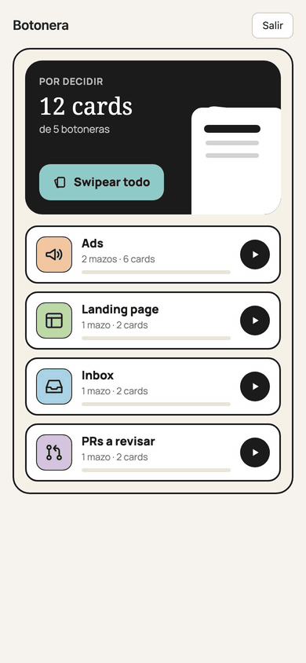

# Botonera

Un skill para tu agente de código que te junta lo que tenés que decidir y te lo deja como cards para
swipear en el celu. Funciona con [Claude Code](https://claude.com/claude-code), Codex, Grok, Cursor o
cualquier agente que pueda correr un comando de Python ([con otros agentes](#con-otros-agentes)). El
agente investiga y recomienda; vos elegís con un dedo. La respuesta vuelve sola a la sesión que
preguntó, y el agente aplica solo lo que marcaste.

<p align="center"></p>

Cada card trae:

- **Qué se decide** y el dato que lo decide, en dos líneas.
- **Qué recomienda el agente y por qué.** El botón recomendado va siempre a la derecha, bordeado, sin marcar.
- **Botones que dicen la acción** («Cerrá el PR» / «Dejalo abierto»), o varias opciones cuando no es un sí o no.
- **«Editar»** para decir que sí con un cambio: los valores que propuso el agente salen cargados en campos
  (texto, número, fecha u opción) y cambiás solo lo que no te cierra. Un comentario libre en cada card,
  y **«+info»** para preguntar sin decidir.
- **«Snooze»** para dejar una botonera entera para más tarde: en su portada, a la izquierda, elegís cuándo vuelve
  (hoy más tarde, mañana, el finde, el lunes, hasta 8 días). Duerme en «Snoozeadas», sin avisos, y vuelve sola
  arriba con tus marcas. Las horas son las de la zona horaria de tu dispositivo.
- **Qué pasa si no decidís**, qué pasó hasta acá y, plegado, el impacto de cada lado.

*English: a skill for your coding agent (Claude Code, Codex, Grok, Cursor, or any agent that can run a
Python command) that turns the pending decisions of a session into swipeable cards on your own phone
web app (PIN-protected, installable as a PWA, with push notifications). The agent researches and
recommends; you swipe. Your answer flows back into the waiting session, which applies only what you
marked. Runs on your own free Supabase project plus any static host (Vercel by
default). Requires Python 3.9+. Docs, card copy and UI are in Spanish.*

## En 3 pasos

1. Creá tu proyecto Supabase y corré `./install.sh` (ver [Instalación](#instalación)).
2. En Claude Code, en medio de cualquier trabajo, decí **`/botonera`**. En otro agente, pedile que siga el `SKILL.md`.
3. Abrí tu botonera en el celu, swipeá y tocá Enviar. La sesión se despierta y aplica.

## Cómo funciona

```
tu agente  ──armar.py──▶ Supabase (tu proyecto) ◀──PIN── tu web en el celu
     ▲                        │                          (swipe, Enviar)
     └──── esperar.py ◀───────┘  la respuesta despierta a la sesión
```

- `armar.py` valida el JSON de la tanda (techos de palabras, campos obligatorios), arma la página y la publica.
- `esperar.py` corre en segundo plano en la sesión y sale cuando decidiste: su salida es tu respuesta. Si snoozeás la botonera, avisa hasta cuándo y la sesión lo relanza.
- `marcar.py` cierra el loop; la web muestra qué se aplicó y qué no.
- `retomar.py` aplica una decisión aunque la sesión que preguntó ya no esté viva: lee la respuesta y el plan de cada card.
- La web no ejecuta nada. Ejecuta siempre la sesión de tu agente.

## Con otros agentes

El skill viene listo para Claude Code, pero el trabajo lo hacen scripts de Python y tu base de
Supabase. Cualquier agente que pueda correr un comando en tu máquina los usa igual:

1. Instalá con `./install.sh --skill-dir <carpeta>`, donde tu agente lea sus instrucciones.
2. Dale el `SKILL.md` como instrucciones (o pedile que lo lea antes de armar una tanda).
3. Poné `BM_SESSION_ID` con un nombre para esa sesión, así la web agrupa sus tandas.
4. El agente publica con `armar.py --publicar` y espera con `esperar.py <clave>`, que sale cuando decidiste.

Dos cosas son solo de Claude Code: el link «Abrir la conversación» de la web y el hook
`entregar.py`. Si tu agente no puede dejar `esperar.py` corriendo hasta que contestes, pedile la
respuesta después con `retomar.py <clave>`. Para un agente al que no querés darle acceso a todo, usá
el [rol de bot](#un-bot-sin-tu-secreto-completo).

## Instalación

Necesitás: Python 3.9+, una cuenta gratis de [Supabase](https://supabase.com), un hosting estático
(abajo, [Vercel](https://vercel.com)) y el [CLI de Supabase](https://supabase.com/docs/guides/cli) para
la función de avisos.

1. **Creá un proyecto en Supabase.** En *Project Settings → API* copiá la URL del proyecto y la
   clave pública (*publishable* o *anon*). La clave pública sola no lee nada: todo pasa por funciones
   que piden tu secreto o tu sesión.

2. **Cloná y corré el instalador:**

   ```bash
   git clone https://github.com/brunogiel/botonera.git
   cd botonera
   ./install.sh --url https://TU-PROYECTO.supabase.co --key TU_CLAVE_PUBLICA
   ```

   Copia el skill a `~/.claude/skills/botonera/`, guarda tu config en `~/.config/botonera/env`
   (permisos 600, con un secreto que se genera ahí y nunca se imprime), escribe `web/config.js` y te
   deja `~/.config/botonera/instalar.sql`.

3. **Pegá `instalar.sql`** en el *SQL Editor* de Supabase y corrélo. Crea las tablas, las funciones y
   los dos cron de avisos, y registra el hash de tu secreto.

4. **Subí la función de avisos** (desde la carpeta del repo):

   ```bash
   supabase login
   supabase functions deploy bm-avisar --project-ref TU-PROYECTO --no-verify-jwt
   ```

   En los 5 minutos siguientes, el cron de la base la llama una vez y la función genera sus claves VAPID.

5. **Subí la web.** Cualquier hosting estático sirve si respeta los headers de `web/vercel.json`. Con Vercel:

   ```bash
   cd web && vercel deploy --prod
   ```

6. **Poné tu PIN** (4 dígitos):

   ```bash
   python3 ~/.claude/skills/botonera/pin.py poner
   ```

7. **En el celu**, abrí la URL de tu web, entrá con el PIN, agregala a la pantalla de inicio y tocá
   **Activar avisos** en el home. En iPhone los avisos funcionan solo con la web agregada a la pantalla de inicio.

8. **En Claude Code** decí `/botonera`.

### Si venís de la 1.0.x

Volvé a correr `./install.sh` (reusa tu secreto y tu config), pegá el `instalar.sql` nuevo en el *SQL Editor*
y redesplegá la web. Las migraciones se pueden repetir, así que no se rompe nada. El skill se pisa con la
versión nueva (el instalador te pregunta antes).

### Opcional: red de seguridad

Si la sesión se reinicia mientras esperaba, la respuesta queda guardada en la base. `entregar.py`
la entrega igual como hook de Claude Code al arrancar cada turno:

```bash
./install.sh --hook   # imprime el bloque para pegar en ~/.claude/settings.json
```

El hook usa el id de sesión que expone la app de escritorio de Claude Code
(`CLAUDE_CODE_HOST_SESSION_ID`). Donde no existe, no hace nada; `esperar.py` sigue siendo el camino principal.

## Uso

- **`/botonera`**: las decisiones abiertas de esta conversación.
- **`/botonera <tema>`**: las de ese tema, proyecto o archivo.
- Las categorías del home se editan en `~/.claude/skills/botonera/categorias.json`. El orden de la
  lista es el orden del home. `privada: true` hace que los avisos no nombren esa categoría.

Mantenimiento:

```bash
python3 ~/.claude/skills/botonera/pendientes.py   # decidido y sin aplicar
python3 ~/.claude/skills/botonera/colgadas.py     # tandas que no cerraron (con su plan de aplicar)
python3 ~/.claude/skills/botonera/retomar.py <clave>   # el brief para aplicar una decisión sin la sesión viva
python3 ~/.claude/skills/botonera/pin.py estado   # PIN, sesiones y avisos
```

Para apagarla, borrá `~/.config/botonera/env`. `armar.py` sigue armando el html local y avisa que no publicó.

### Editar y retomar

- Una card sí/no puede traer `campos` (hasta 5): lo que Claude propone, listo para editar. La respuesta
  vuelve con lo que cambiaste: `1. va con cambios · título → acción · campos: precio=4200 (antes 3500)`.
- Cada card puede traer `aplicar`: el plan de cada respuesta posible (≤40 palabras). Si la sesión murió,
  `retomar.py <clave>` junta tu respuesta y esos planes en un brief que cualquier sesión nueva puede aplicar.

### Fila «Con error»

Lo que murió sin avisar (una tarea programada que pegó el límite de uso, una tanda archivada con tu respuesta sin
aplicar) aparece arriba del home hasta que tocás **Visto**. Se publica con `errores.py`:

```bash
python3 ~/.claude/skills/botonera/errores.py publicar '{"tipo":"tarea","origen_id":"mi-tarea","titulo":"Reporte semanal","motivo":"Límite de uso"}'
```

`colgadas.py --archivar <clave> "<por qué>"` publica solo un error cuando archiva una tanda que ya tenía tu respuesta.

### Un bot, sin tu secreto completo

Un agente al que no querés darle tu secreto completo puede publicar tandas y recibir tus respuestas con un
secreto propio, que solo sirve para claves `bot-…`:

```bash
python3 ~/.claude/skills/botonera/secret-bot.py   # escribe ~/.config/botonera/env-bot e imprime el SQL con su hash
```

Ejecutá ese SQL en el *SQL Editor* y dale el contenido de `env-bot` al bot (o sus tres claves como variables
de entorno). El bot publica con `BM_SESSION_ID=bot-<nombre>` y una `clave` que empieza con `bot-`; no ve el
resto de las tandas, ni el PIN, ni publica errores. Para darlo de baja:
`delete from public.bm_config where k = 'bot_secret_sha256';`.

## Privacidad

- Las tandas viven en **tu** proyecto Supabase. No hay servidor de nadie más en el medio.
- Las tablas tienen RLS prendido y ninguna política: no se leen ni con la clave pública. Las funciones
  piden tu secreto (los scripts) o un token de sesión que da el PIN (la web). Diez PIN mal seguidos
  bloquean la entrada hasta `pin.py desbloquear`.
- Los avisos push llevan solo conteos y nombres de categoría, nunca el texto de una card. Las claves
  VAPID se generan en tu proyecto y la privada queda en Vault.

## Probar en local

Con Docker y el CLI de Supabase, y los puertos 54321 a 54323 libres:

```bash
supabase start                       # aplica las migraciones solas
python3 tests/prueba_local.py        # publica, entra con PIN, decide, recibe, marca, retoma y prueba el rol de bot
```

La prueba usa un HOME temporal (no toca tu `~/.claude` ni tu `~/.config`), aplica la config con
`docker exec` (no hace falta `psql`) y solo corre contra localhost.

La web tiene su propia prueba, sin Supabase (le inyecta un stub a la librería y corta la red):

```bash
cd tests && npm install && npx playwright install chromium   # una vez
node e2e-editar.js                                           # Editar, +info, el contador y la fila «Con error»
```

Correla antes de tocar `web/index.html`: todos los casos tienen que dar PASA.

## Licencia

MIT.
